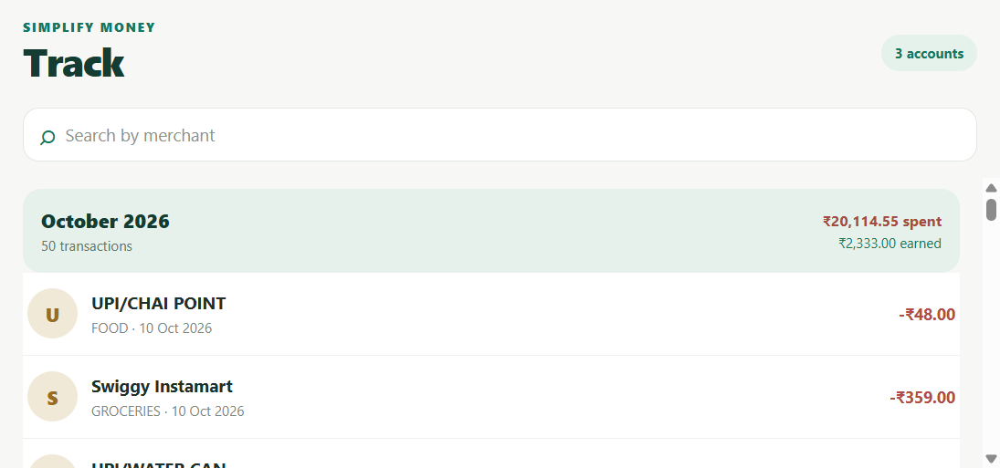
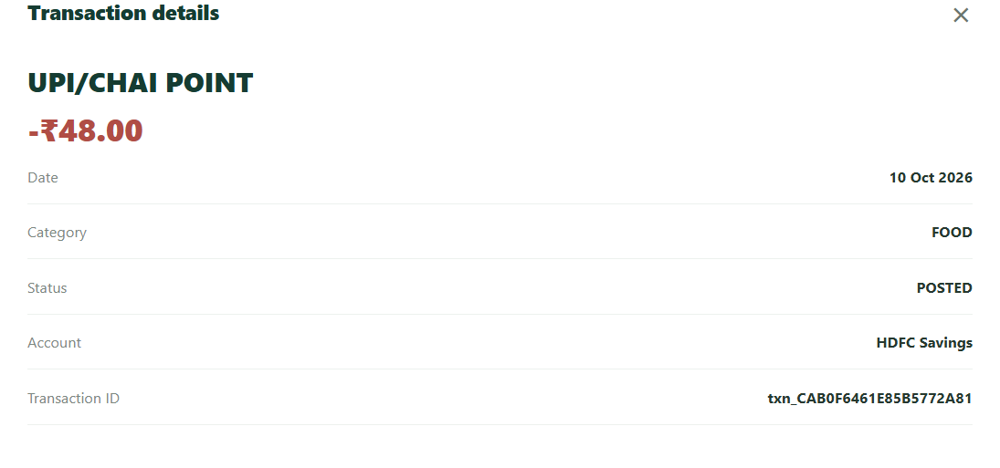

# Task 0 — referrals and feedback

## Evidence captured

The local implementation was run against the mock Track API. These screenshots document the
working transaction list and detail interaction:

- [Track screen](./task-0-track-screen.png)
- [Transaction detail](./task-0-transaction-detail.png)

## Feedback

The repository does not contain feedback captured from the real Simplify Money app. That
feedback must be added from the actual app session before submission; the screenshots above are
implementation evidence, not a claim about the production app.

## Referrals

The repository does not contain referral names, timestamps, or other referral evidence. Add only
referrals that were actually completed, with any personally identifying information removed.

## Social follows

No evidence of the requested LinkedIn, Instagram, or YouTube follows is stored in this
repository. Confirm these manually before submitting.
